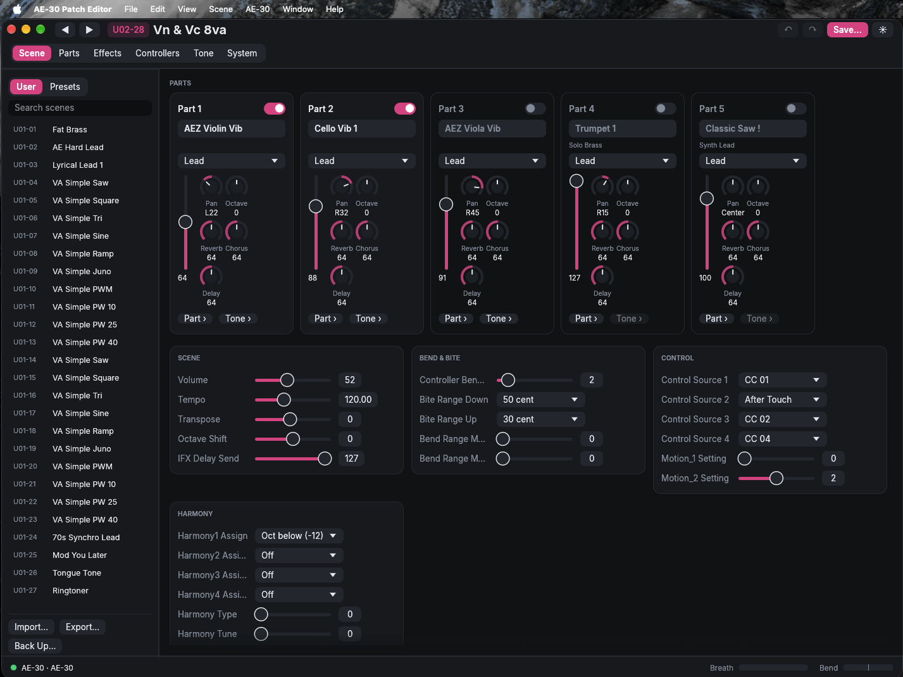
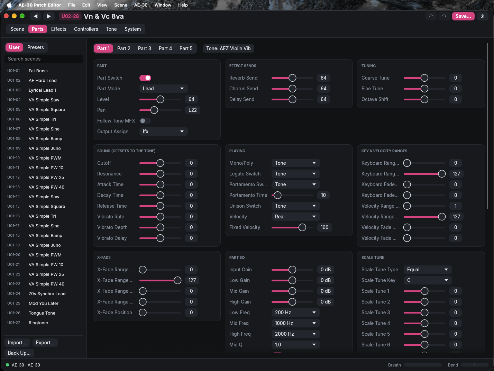
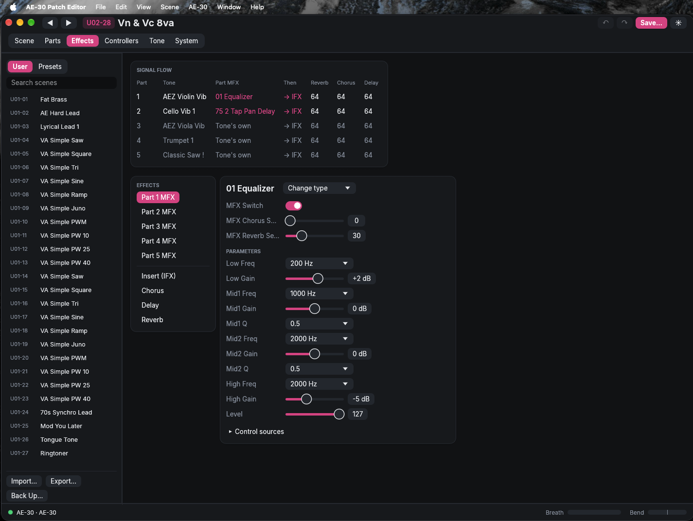
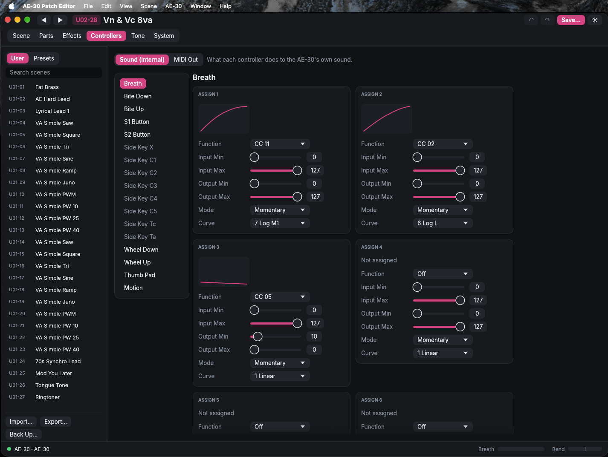
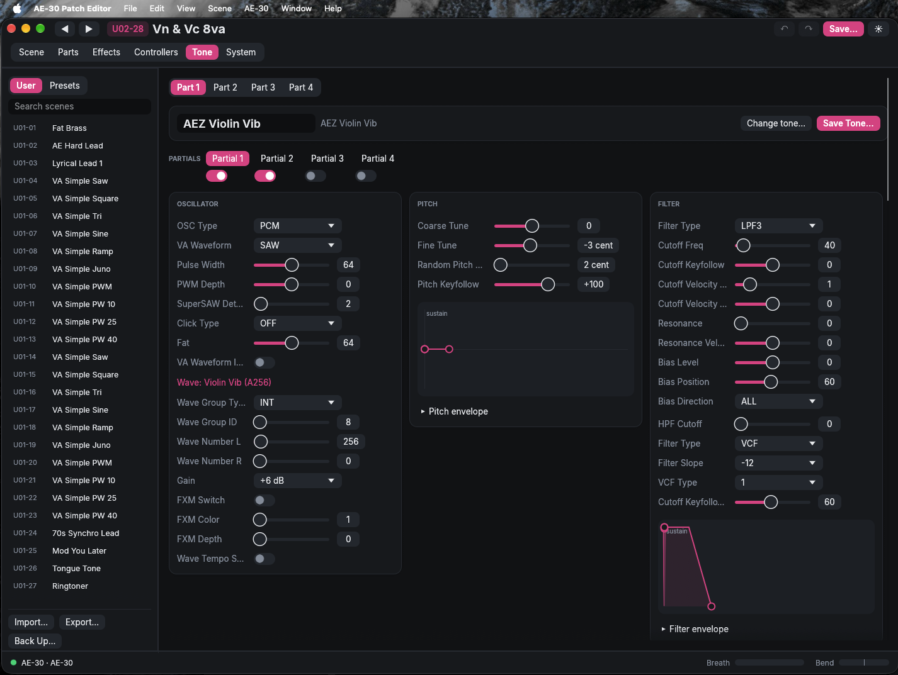
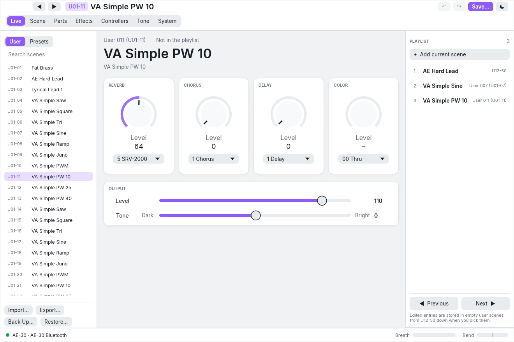
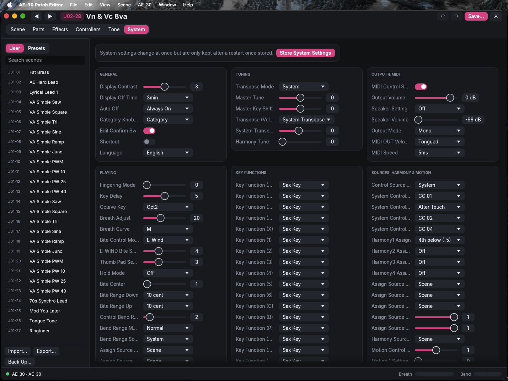

# RolandAerophoneEditor

A scene and tone editor for the Roland Aerophone Pro AE-30 (and AE-20), written in Rust. It talks to the instrument over USB MIDI (or Bluetooth MIDI on macOS) using Roland's SysEx protocol. Every change is sent to the AE-30 as you make it, so you hear it immediately.

Copyright © 2027 Eric Dannewitz. If you find it useful, you can [buy me a coffee](https://buymeacoffee.com/ericdannewitz).

## Features

- **Scene:** a five-part mixer with level, pan, octave and reverb/chorus/delay sends, plus tempo, transpose, bend and bite ranges, control sources and harmony.

  

- **Parts:** every part setting, including tuning, sound offsets, mono/poly, portamento, key and velocity ranges, X-Fade, scale tune, receive switches and part EQ.

  

- **Effects:** a signal-flow overview and the controls for each type of the part MFX, IFX, chorus, delay and reverb.

  

- **Controllers:** breath, bite, S1/S2, side keys, wheel, thumb pad and motion, for both the internal sound and MIDI Out, each with its response curve.

  

- **Tone:** a ZEN-Core tone editor covering oscillators, pitch, filter, amp, envelopes you can drag, two LFOs, matrix control, partial EQ, structure and the tone's effect.

  

- **Live:** a performance screen with the scene's name, big knobs for reverb, chorus, delay and Color (the insert effect) with a type menu under each, and sliders for level and dark/bright. On the right, named setlists hold your scenes for each gig (create, rename, switch and delete them from the setlist menu; Select lets you tick entries to remove, or clear a whole setlist); click an entry, or use the arrow keys or Page Up/Down (most page-turner pedals send these), to switch. Each entry keeps its own copy of the scene, including tweaks you make while it plays. Nothing is stored until you pick an edited entry again: it is then saved in an empty user scene, counting down from U12-50 (only slots named INIT SCENE are used), so later picks are instant.

  

- **System:** the instrument's global settings.

  

- **Library:**
  - searchable user and preset scene lists
  - saving to a user scene or user tone
  - import and export of `.syx` scene files
  - a backup of user scenes to a single `.syx` file, and restoring it with every scene checked
- **Live feedback:** breath and pitch bend meters, the playing note, and edits made on the AE-30's panel appear in the editor.
- **Mac and Windows:** a native menu bar and unified title bar on macOS, and a menu in the window on Windows. Preferences cover theme, accent colour, corners, interface size and knob speed.

## Building

You need [Rust](https://rustup.rs) installed.

```bash
cd rust
cargo run --release --bin ae30edit            # the editor
cargo run --release --bin ae30edit -- help    # command-line tools (probe, backup, …)
cargo test
```

Packages:

- `rust/scripts/build-macos.sh`: a universal `AE-30 Patch Editor.app` and `.dmg`
- `rust/scripts/build-windows.sh`: a Windows 10/11 zip, cross-compiled on macOS (needs `rustup target add x86_64-pc-windows-gnu` and `brew install mingw-w64`)

## Connecting the AE-30

Connect it by USB. If your computer doesn't see it, install Roland's AE-30 USB driver or set the AE-30's USB driver mode to Generic. Close Roland's phone app while editing, so the two don't conflict. The editor finds the AE-30 automatically and reconnects if you unplug it.

### Bluetooth (macOS)

Bluetooth MIDI works on macOS, even though Roland only lists iOS for it. It is slower than USB, but loading, live editing and backups all work.

1. Unplug the USB cable and turn on Bluetooth on the AE-30.
2. Open **Audio MIDI Setup**, choose **Window → Show MIDI Studio**, and click the **Bluetooth** icon in the toolbar. (Pairing in System Settings → Bluetooth does not set up MIDI.)
3. Find the AE-30 in the list and click **Connect**.

The AE-30 then appears as "AE-30 Bluetooth", and the editor finds it automatically. If USB is also connected, the editor uses USB. To choose Bluetooth instead, start it with `--port Bluetooth`.

Windows does not support Bluetooth MIDI devices through the standard MIDI system the editor uses, so connect by USB there.

## Protocol notes

[`AE30_SYSEX_NOTES.md`](AE30_SYSEX_NOTES.md) documents the SysEx protocol, the address map, and the behaviour found by testing on a real AE-30.

## Licence and credits

This project is licensed under the GNU GPL v3 or later ([LICENSE](LICENSE)).

- The parameter tables (`rust/ae30-core/data/ae30.json`) are generated by `tools/gen_data.py` from the [aerophoneCompanion](https://github.com/wrongwaycorrigan/aerophoneCompanion) project (MIT), which built them from Roland's published MIDI Implementation, Parameter Guide and Scene List.
- The Inter font is under the SIL Open Font License.

See [THIRD_PARTY_NOTICES.md](THIRD_PARTY_NOTICES.md) for both notices.

This project is not affiliated with or endorsed by Roland Corporation. "Roland" and "Aerophone" are trademarks of Roland Corporation.
